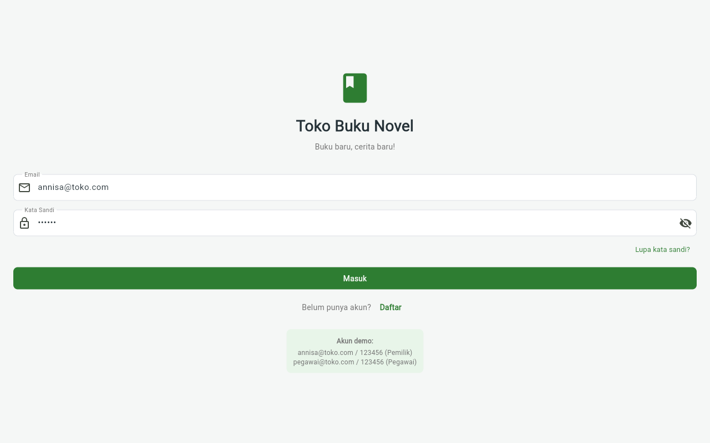
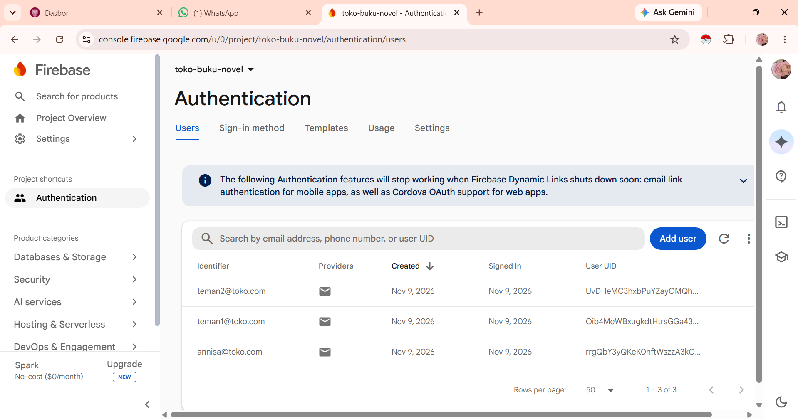
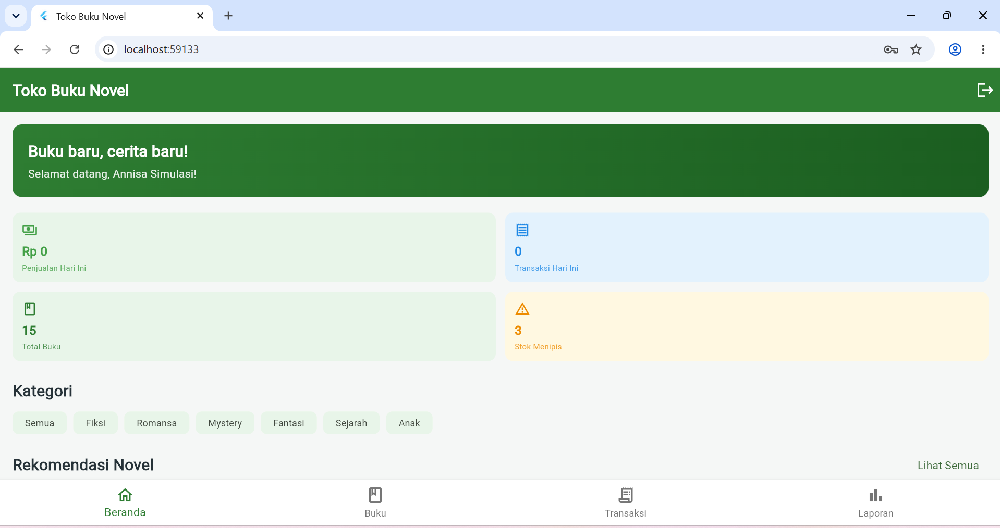
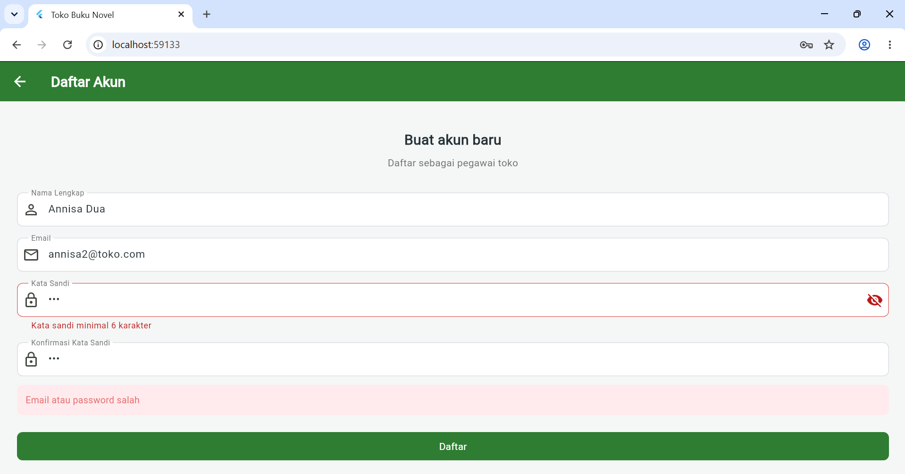
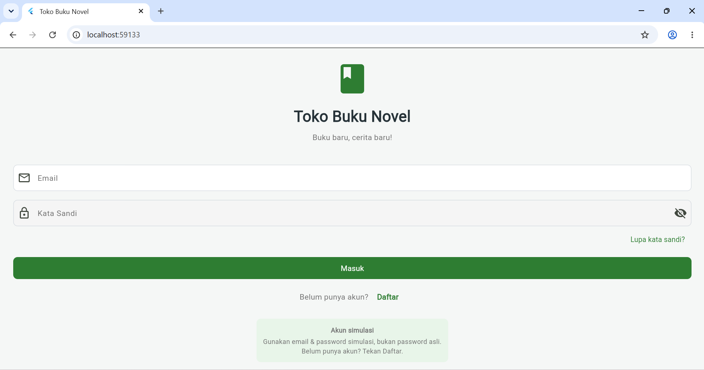
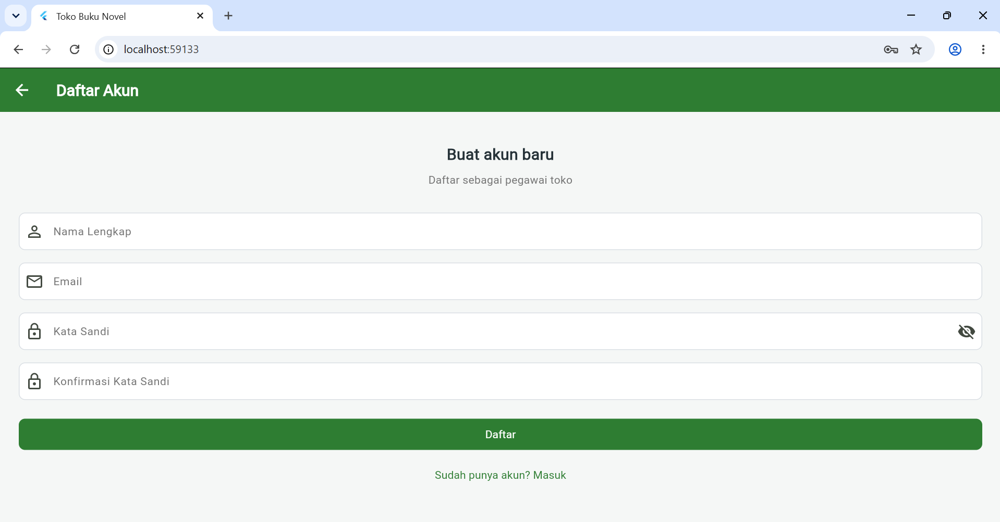
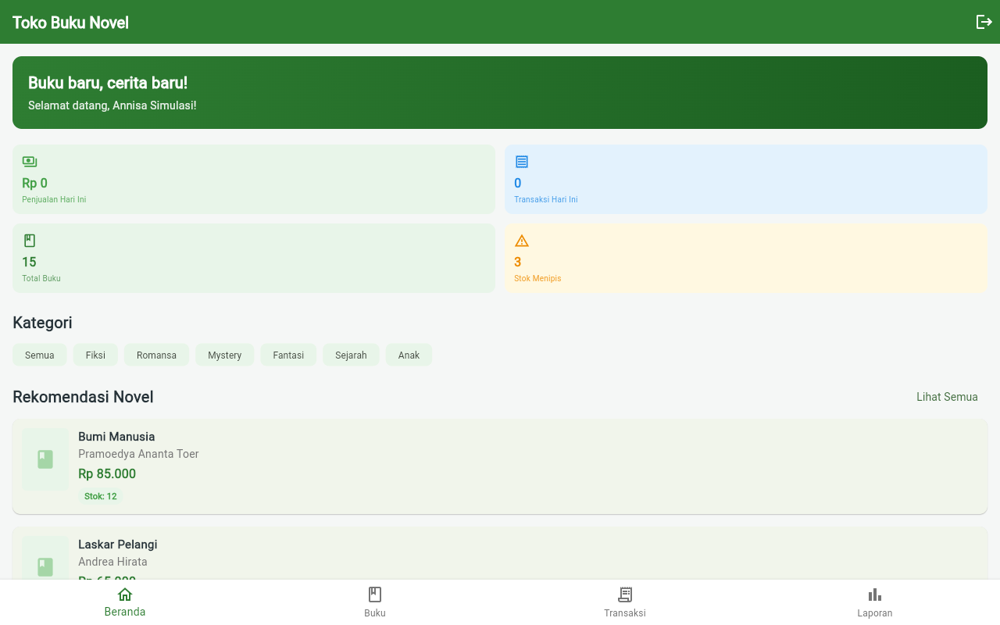
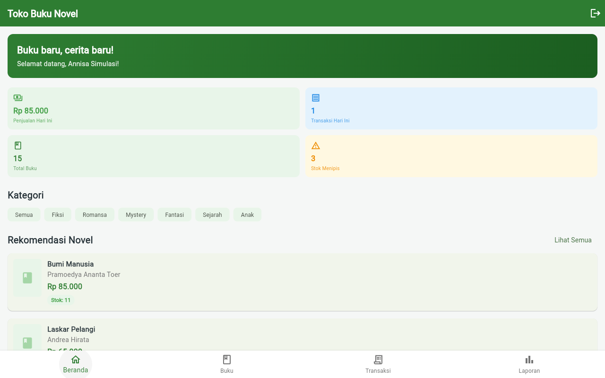
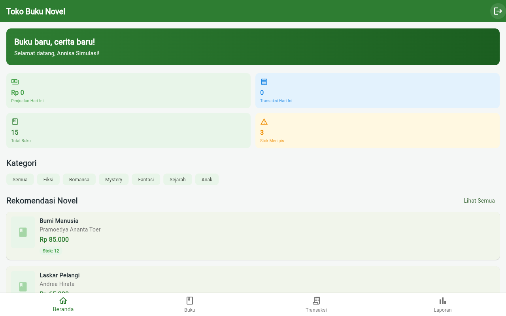

# Toko Buku Novel

Aplikasi toko buku novel dengan fitur manajemen katalog, transaksi penjualan, dan laporan. Proyek individu MK Mobile and Web Application Development.

## Identitas

- **Nama**: Annisa Asti Indriyani
- **NIM**: 2301550007
- **Kelas**: A1 & A2DLC
- **Semester**: Ganjil 2026/2027

## Tautan

- **Repository GitHub**: [UTS_MOBILE_AND_WEB_APPLICATION_DEVELOPMENT_TOKOBUKUNOVEL_2301550007](https://github.com/nicawimutzzz/UTS_MOBILE_AND_WEB_APPLICATION_DEVELOPMENT_TOKOBUKUNOVEL_2301550007)
- **Desain Figma (Wireframe Minggu 4)**: [TokoBukuNovel – Wireframe](https://www.figma.com/design/MyIaaWgf0s38K0u3TrqRdP/-2301550007--%E2%80%93--TokoBukuNovel--%E2%80%93--Wireframe)
- **Proposal UTS**: [docs/Proposal_UTS_Annisa_Asti_Indriyani.docx](docs/Proposal_UTS_Annisa_Asti_Indriyani.docx)

## Deskripsi Singkat

Toko Buku Novel adalah aplikasi kasir dan katalog untuk toko buku. Pengguna dapat login, melihat ringkasan penjualan di beranda, mengelola data buku (tambah/edit, cari, filter kategori), melakukan transaksi penjualan dengan keranjang dan validasi stok, serta melihat laporan penjualan per periode.

**Fitur utama (Fase 1):**
- Login & Register
- Beranda dengan dashboard ringkasan
- Manajemen buku (CRUD + pencarian + filter kategori)
- Transaksi penjualan dengan keranjang
- Laporan penjualan dengan filter tanggal

**Akun login (Minggu 9 — Firebase Authentication):**
Sejak Minggu 9, login memakai **Firebase Auth Email/Password**, bukan lagi akun demo lokal. Sebelum menjalankan aplikasi:
1. Aktifkan **Email/Password** di Firebase Console → *Build → Authentication → Sign-in method* untuk project `toko-buku-novel` (paket Spark, tanpa billing account).
2. Tekan **Daftar** di aplikasi untuk membuat akun simulasi, misalnya `annisa@toko.com` / `toko123456`. **Jangan memakai password asli.**
3. Akun yang berhasil dibuat akan muncul di **Authentication > Users** (salah satu luaran wajib Minggu 9).

> Akun demo lama (`annisa@toko.com` / `123456`, `pegawai@toko.com` / `123456`) hanya berlaku pada `LocalAuthRepository`, yang kini dipakai oleh widget test.

## Cara Menjalankan

```bash
cd tokobukunovel
flutter pub get
flutter run -d chrome   # atau: flutter run (untuk device lain)
```

## Screenshot



*Halaman beranda aplikasi TokoBukuNovel menampilkan dashboard ringkasan penjualan, katalog buku, dan navigasi bottom bar.*

### Bukti Minggu 9 — Firebase Login



*Firebase Console → Authentication → Users: **3 akun** (`annisa@toko.com`, `teman1@toko.com`, `teman2@toko.com`) terdaftar dengan provider Email/Password, Created & Signed In 9 Nov 2026, `1–3 of 3`, pada paket Spark No-cost $0/month.*



*Beranda tampil otomatis setelah menekan **Daftar**, dengan sapaan "Selamat datang, Annisa Simulasi!" yang berasal dari `displayName` Firebase — bukti `_AuthGate` berpindah halaman mengikuti `authStateChanges()`.*

### Bukti perbaikan temuan uji (sebelum / sesudah)



*Screenshot 3 (sebelum perbaikan): halaman Daftar masih memuat kotak merah `Email atau password salah` yang terbawa dari login gagal sebelumnya — inilah temuan uji.*



*Screenshot 4: titik awal alur uji. Tautan kecil **Belum punya akun? Daftar** berada tepat di bawah tombol **Masuk**.*



*Screenshot 5 (sesudah `resetStatus()` + hot reload): setelah login gagal lalu klik **Daftar**, halaman Daftar bersih tanpa kotak merah sisa. Bukti kualitatif; verifikasi objektif lewat modul DDC ada di Bagian L.2 lembar kerja.*

### Bukti kasus 1 dan 10 (tabel uji 10/10)



*Screenshot 6: login `annisa@toko.com` / `toko123456` membuka Beranda dengan sapaan "Selamat datang, Annisa Simulasi!" tanpa pesan error.*



*Screenshot 7: setelah 1 transaksi Rp 85.000 → Penjualan Hari Ini **Rp 85.000**, Transaksi Hari Ini **1**, stok Bumi Manusia **11**.*



*Screenshot 8: sesudah refresh → **Rp 0**, **0 transaksi**, stok kembali **12**. Sesi login tetap bertahan, data bisnis belum persisten (in-memory) → materi Minggu 10: Cloud Firestore.*

## Struktur Project

```
lib/
├── main.dart              # Entry point + dependency injection
├── app.dart               # MaterialApp + auth gate
├── models/                # Book, Transaction, User, Category
├── repositories/          # Interface + implementasi (local/, firebase/)
├── providers/             # State management (ChangeNotifier)
├── pages/                 # Halaman aplikasi
├── widgets/               # Komponen reusable
├── theme/                 # Warna, tipografi, gaya tombol
└── utils/                 # Format Rupiah, validators
```

**Catatan arsitektur**: local-first dengan Repository Pattern. **Autentikasi sudah memakai Firebase Authentication** sejak Minggu 9 (`FirebaseAuthRepository`, `authStateChanges()` + `_AuthGate`), sehingga sesi login bertahan setelah refresh. Katalog buku, transaksi, dan laporan masih disimpan di memori (`LocalBookRepository` / `LocalTransactionRepository`); pemindahan ke Cloud Firestore direncanakan pada Minggu 10 dan cukup mengganti implementasi repository tanpa mengubah UI.

## Dokumen UTS

| Dokumen | Lokasi |
|---------|--------|
| Proposal UTS (DOCX) | `docs/Proposal_UTS_Annisa_Asti_Indriyani.docx` |
| Proposal UTS (Markdown) | `docs/Proposal_UTS_Annisa_Asti_Indriyani.md` |
| Rencana Video Remotion | `docs/Rencana_Video_Remotion_UTS.md` |
| Skrip Video Presentasi | `docs/Skrip_Video_UTS_Annisa_Asti_Indriyani.md` |
| Panduan Minggu 9 — Firebase Login | `docs/Panduan_Minggu9_Firebase_Login.md` |
| Lembar Kerja Minggu 9 (siap kumpul) | `docs/Lembar_Kerja_Minggu9_Annisa_Asti_Indriyani.docx` |

## Minggu 9 — Firebase Login

| Butir | Keterangan |
|---|---|
| Project Firebase | `toko-buku-novel` (paket Spark, tanpa billing account) |
| Penyedia login | Email/Password |
| Inisialisasi | `await Firebase.initializeApp(options: DefaultFirebaseOptions.currentPlatform)` di `lib/main.dart` |
| Status login | `_AuthGate` + `StreamBuilder` + `authStateChanges()` di `lib/app.dart` |
| Pesan kesalahan | `lib/utils/auth_errors.dart` — 8 kode `FirebaseAuthException` diterjemahkan ke bahasa pengguna |
| Target uji | Chrome (`flutter run -d chrome`) |
| Verifikasi | `flutter pub get` ✅ · `flutter analyze` **0 error** ✅ · `flutter build web` ✅ |
| Tabel uji | **10 dari 10 kasus terisi** ✅ — jauh melebihi syarat minimal 5 |
| Bukti | 8 screenshot di `docs/`: 2 bukti Firebase, 3 bukti sebelum/sesudah perbaikan temuan, 3 bukti kasus 1 & 10 |
| Uji teman | 1 temuan diperbaiki: pesan error terbawa antar halaman → `resetStatus()` sebelum navigasi Masuk ↔ Daftar; **terverifikasi visual** di Chrome 9 Nov 2026 pukul 20:52 |
| Hot reload | `Reloaded application in 6,540ms`; modul DDC `login_page.dart.lib.js` & `register_page.dart.lib.js` memuat panggilan `resetStatus()` |

Panduan langkah demi langkah, tabel uji 10 kasus, jawaban refleksi, **Bagian L.2 (temuan uji teman dan perbaikannya)**, **Bagian L.3 (bukti visual sebelum/sesudah)**, serta **Bagian M (bukti kasus 1 & 10)** tersedia di `docs/Panduan_Minggu9_Firebase_Login.md` dan `docs/Lembar_Kerja_Minggu9_Annisa_Asti_Indriyani.docx`. **Seluruh 10 kasus uji sudah terisi hasil nyatanya**; 8 screenshot bukti tertanam di lembar kerja DOCX. Kasus 1 dan 10 diverifikasi dengan otomasi browser (Playwright + Chrome) terhadap aplikasi dan Firebase asli — dicatat transparan di Bagian M. Temuan kasus 10 (data bisnis belum persisten) menjadi pengantar Minggu 10: Cloud Firestore.

> Catatan lingkungan: `flutter test` pada mesin ini gagal dengan `WebSocketException: Invalid WebSocket upgrade request` (masalah `flutter_tester`, bukan kode). Pembuktian kompilasi dilakukan melalui `flutter analyze` dan `flutter build web`.

## Video Presentasi UTS

Video dibuat menggunakan Remotion (React video framework) + edge-tts (TTS gratis Bahasa Indonesia).

```bash
cd video-uts
npm install
npm run dev      # preview di Remotion Studio
npm run render   # render ke out/uts-tokobukunovel.mp4
```

**Voice**: id-ID-GadisNeural (Microsoft Edge TTS)
**Durasi**: ~6.5 menit | **Resolusi**: 720p | **7 scene**

## Riwayat Commit

| # | Commit | Tanggal | Pesan |
|---|--------|---------|-------|
| 1 | `b28f148` | 26 Okt 2026 | Inisialisasi project Flutter TokoBukuNovel |
| 2 | `9cbadf4` | 26 Okt 2026 | Tambah README dan screenshot |
| 3 | `fd04d4a` | 2 Nov 2026 | Perbaiki widget test: ganti test bawaan template dengan test halaman login |
| 4 | `dd25263` | 2 Nov 2026 | Initial commit (merge remote) |
| 5 | `b5b15a7` | 2 Nov 2026 | UTS: Tambah proposal, video Remotion + TTS, dan perbarui README |
| 6 | `31ed940` | 2 Nov 2026 | Merge remote README, keep local version |
| 7 | `347d975` | 4 Nov 2026 | README: tambah section Screenshot dan Riwayat Commit |
| 8 | `9b3f13d` | 9 Nov 2026 | README: lengkapi tabel Riwayat Commit dengan commit ke-7 |
| 9 | `d2349ab` | 9 Nov 2026 | Minggu 9 (Latihan 1): Hubungkan project ke Firebase |
| 10 | `5ffd89c` | 9 Nov 2026 | Minggu 9 (Latihan 2–4): login Firebase, auth gate, pesan kesalahan, panduan + lembar kerja |
| 11 | `18a8812` | 9 Nov 2026 | README: status Minggu 9 (Firebase Auth), dokumen, dan riwayat commit |
| 12 | `5732dc7` | 9 Nov 2026 | Minggu 9: lengkapi lembar kerja dengan hash commit aktual |
| 13 | `1deb073` | 9 Nov 2026 | Minggu 9: tambah 2 screenshot bukti dan tempelkan ke lembar kerja |
| 14 | `81277a6` | 9 Nov 2026 | Minggu 9: isi hasil nyata kasus 8 (refresh) dan 9 (keluar) |
| 15 | `c942d95` | 9 Nov 2026 | Minggu 9: isi hasil nyata kasus 2–4, tabel uji kini 5 kasus terpenuhi |
| 16 | `42eda55` | 9 Nov 2026 | Minggu 9: perbaiki temuan uji (resetStatus saat navigasi), tabel uji jadi 8 kasus, Bagian L.2 |
| 17 | `00f40bb` | 9 Nov 2026 | Minggu 9: bukti Authentication > Users diperbarui menjadi 3 akun, caption DOCX/README disamakan |
| 18 | `c299164` | 9 Nov 2026 | Minggu 9: sinkronisasi bukti commit ke README dan lembar kerja |
| 19 | `066746d` | 9 Nov 2026 | README: catat commit bukti 3 akun di Riwayat Commit |
| 20 | `e358542` | 9 Nov 2026 | Minggu 9: catat bukti hot reload dan verifikasi modul DDC `resetStatus()` di lembar kerja |
| 21 | `1e71cd0` | 9 Nov 2026 | Minggu 9: Bagian L.3 — 3 screenshot bukti sebelum/sesudah perbaikan temuan + verifikasi visual |
| 22 | `f15186c` | 9 Nov 2026 | Minggu 9: catat commit bukti L.3 di README dan lembar kerja |
| 23 | `95bdb5b` | 9 Nov 2026 | Minggu 9: lengkapi 10/10 kasus uji (kasus 1 & 10) + Bagian M, 3 screenshot baru |

Riwayat commit bertahap dari minggu 5 (26 Okt) hingga Minggu 9 (9 Nov), mencakup inisialisasi project, penambahan dokumentasi, perbaikan test, submission UTS, penyempurnaan README, integrasi Firebase Authentication, pengisian tabel uji, dan perbaikan temuan uji teman. Riwayat lengkap dapat dilihat dengan `git log --oneline`.
